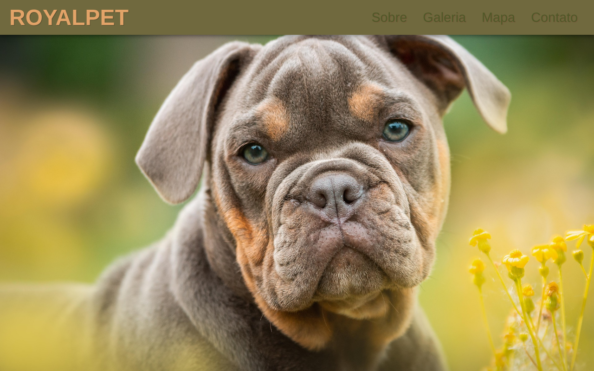
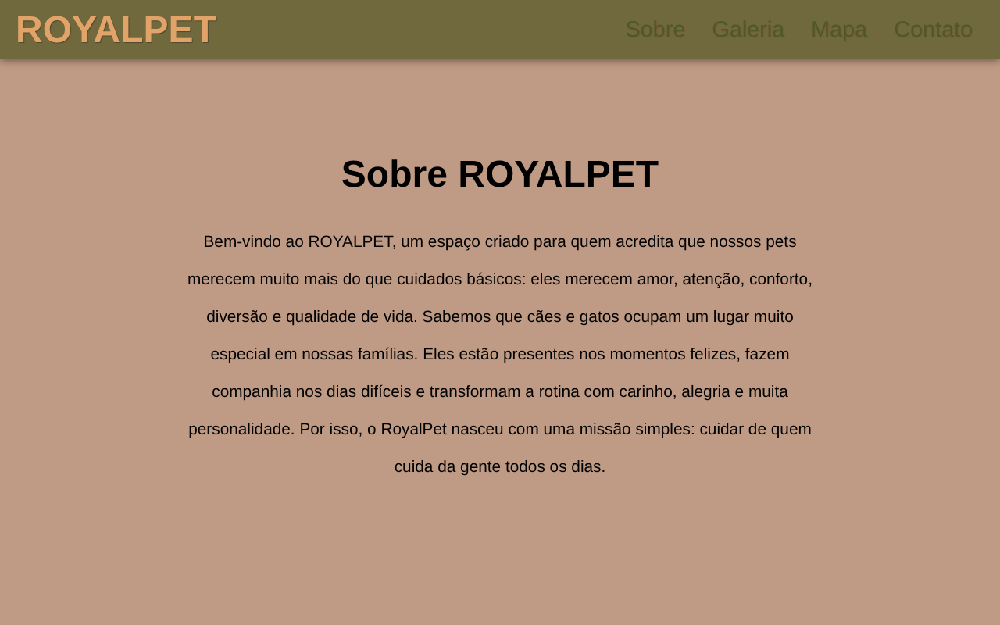
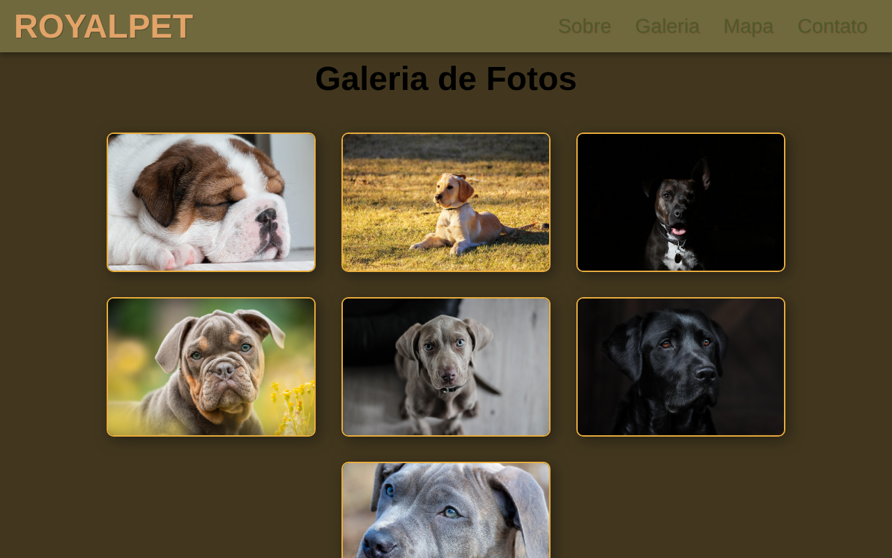

# 🐾 ROYALPET — Site institucional para pet shop

> Site de uma página para o pet shop fictício ROYALPET, feito com HTML5 e CSS3 puros, com apresentação, galeria de fotos e formulário de contato.


Projeto prático desenvolvido no 1º semestre de 2026 no curso de **Análise e Desenvolvimento de Sistemas (UDF)**.



---

## 📌 Visão geral

**Problema:** pequenos pet shops muitas vezes não têm presença na internet, e o cliente não encontra um lugar simples para conhecer o espaço, ver fotos e entrar em contato.

**Solução:** um site de página única que apresenta o ROYALPET, mostra uma galeria com fotos dos pets e oferece um formulário de contato, tudo acessível por um menu fixo no topo.

**Funcionalidades:**
- [x] Menu de navegação fixo com links para cada seção (âncoras)
- [x] Banner de destaque em tela cheia
- [x] Seção "Sobre" com a apresentação do pet shop
- [x] Galeria com 7 fotos e efeito de zoom ao passar o mouse
- [x] Formulário de contato (nome, e-mail e mensagem)
- [ ] Seção de mapa com a localização (próxima melhoria)

---

## 🛠 Tecnologias utilizadas

| Tecnologia | Uso no projeto |
| --- | --- |
| HTML5 | Estrutura semântica da página (`header`, `nav`, `main`, `section`, `footer`) |
| CSS3 | Layout com Flexbox, cabeçalho fixo, imagem de fundo, transições e efeito hover |
| Git e GitHub | Versionamento e publicação |

Não usa frameworks nem bibliotecas: é só abrir no navegador.

---

## ▶️ Como executar

### Pré-requisitos
- [Git](https://git-scm.com/) (opcional, só para clonar)
- Um navegador (Chrome, Firefox ou Edge)

### Passo a passo

```bash
# 1. Clone o repositório
git clone https://github.com/anaqueiroz08/royalpet-site-html-css.git

# 2. Entre na pasta
cd royalpet-site-html-css
```

3. Abra o arquivo `index.html` no navegador (duplo clique), ou no VS Code clique com o botão direito em `index.html` → **Open with Live Server**.

Sem Git: clique em **Code → Download ZIP**, extraia e abra o `index.html`.

---

## 🖼 Demonstração

| Seção "Sobre" | Galeria de fotos |
| --- | --- |
|  |  |

---

## 📁 Estrutura de arquivos

```
royalpet-site-html-css/
├── index.html            # página principal
├── style.css             # estilos do site
├── 1.jpg ... 7.jpg       # fotos da galeria e do banner
├── tela-inicial.png      # prints usados neste README
├── about.png
├── gallery.png
├── .gitignore
├── LICENSE
└── README.md
```

---

## 🚧 Próximas melhorias

- Adicionar o mapa do Google Maps na seção "Mapa"
- Estilizar o formulário de contato
- Deixar o menu responsivo para celular

---

## 👩‍💻 Autora

**Ana Caroline Santos Queiroz**

[](https://www.linkedin.com/in/anaqueiroz04/)
[](https://github.com/anaqueiroz08)

---

## 📄 Licença

Este projeto está sob a licença MIT. Veja o arquivo [LICENSE](LICENSE) para mais detalhes.
